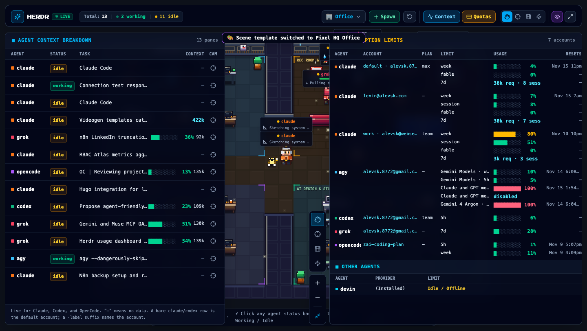
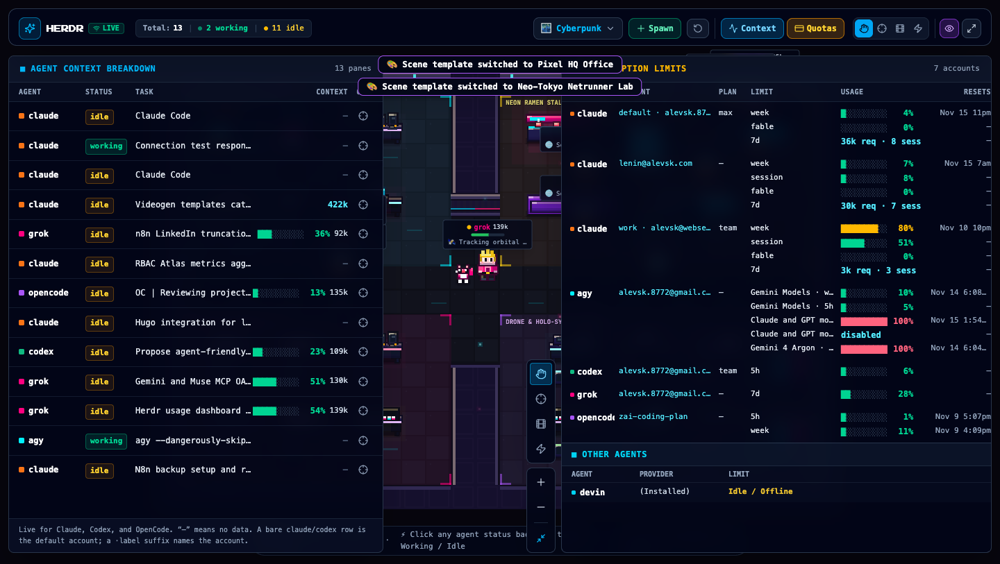
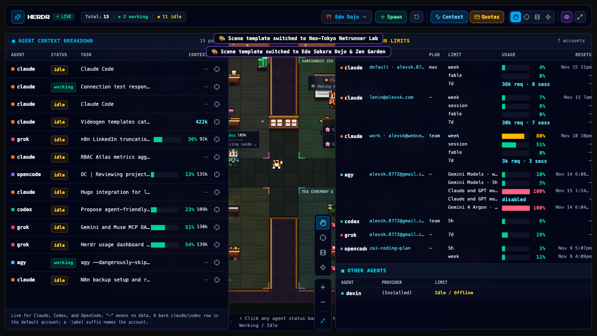
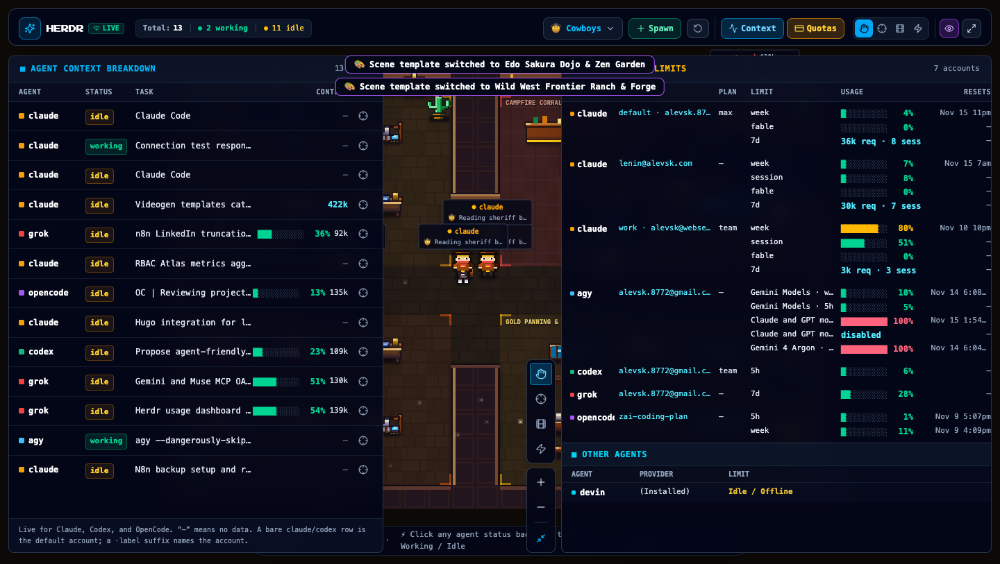
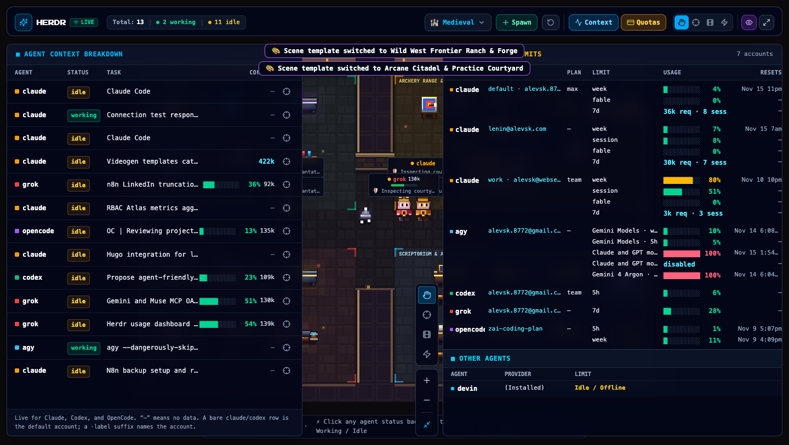
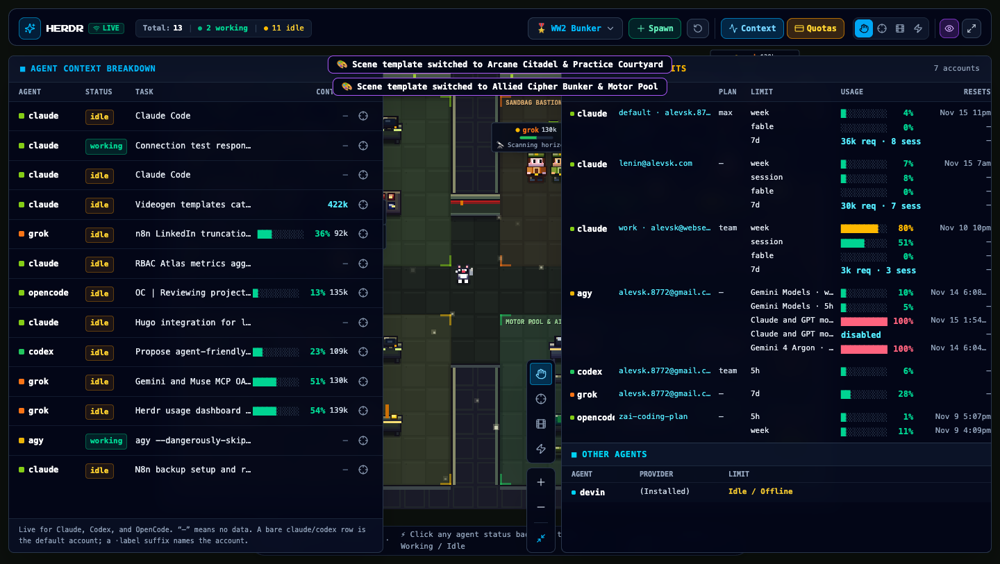
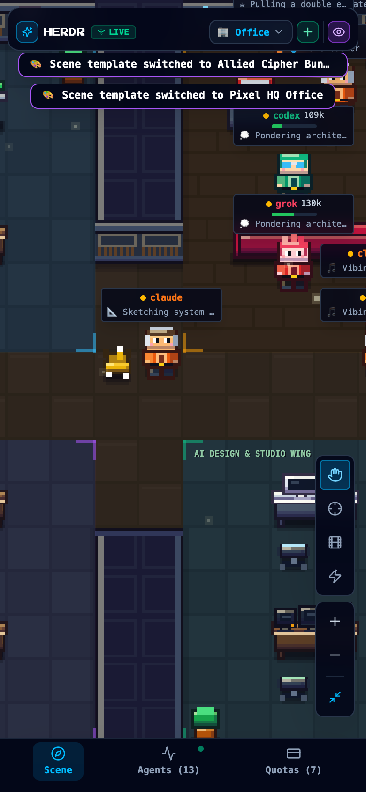

# Agent Plaza

<p align="center">
  
</p>

<p align="center">
  <a href="https://golang.org"></a>
  <a href="https://react.dev"></a>
  <a href="https://www.typescriptlang.org"></a>
  <a href="https://tailwindcss.com"></a>
  <a href="https://www.docker.com"></a>
  <a href="LICENSE"></a>
</p>

A **Hi-Bit Pixel Art** real-time visualizer, cozy virtual habitat, and multi-account subscription telemetry dashboard for AI coding agents (**Claude Code**, **Codex**, **Grok**, **OpenCode**, **Antigravity**, **Gemini**, **Cursor**, **Devin**, and **Aider**).

Inspired by [pixel-agents](https://github.com/pixel-agents-hq/pixel-agents) and D-Pad Studio's **Hi-Bit** aesthetic (*Owlboy*, *Sea of Stars*, *Octopath Traveler*), paired with live agent context tracking and multi-account quota observability via `herdr` and local transcripts.

---

## 🎨 Theme Showcase

Agent Plaza includes **6 self-contained scene templates** that can be hot-swapped instantly from the UI or via API/config:

| 🌆 **Neon Netrunner Deck (`cyberpunk`)** | ⛩️ **Edo Samurai Dojo (`japanese`)** |
|:---:|:---:|
|  |  |
| 🤠 **Wild West Saloon & Forge (`cowboys`)** | 🏰 **Arcane Guild Hall (`medieval`)** |
|  |  |
| 🎖️ **Allied Command Bunker (`ww2`)** | 📱 **Mobile Responsive Viewport** |
|  |  |

---

## ✨ Key Features

- **Hi-Bit Pixel Art Engine (60 FPS Canvas 2D)**:
  - 5-stop hue-shifted shading ramps (cool indigo shadows, warm highlights), Bayer 2×2 ordered dither, specular furniture bevels, additive dynamic lighting, and footstep dust particles.
  - **4-Layer Contrast System**: Desaturated architectural floors (`L = 13%–22%`) ensure characters and HUD badges remain crisp and readable without visual noise.
- **Dynamic Companion Pets**:
  - Interactive companion pets (**cats**, **dogs**, and **robots**) roam alongside agents with custom 4-directional procedural pixel sprites and playful idle behaviors.
- **Retro 8-Bit Sound Effects Suite**:
  - High-quality retro sound effects generated with ElevenLabs for agent work typing, task completion, pet interactions (cats, dogs, robots), theme warp transitions, toasts, and UI clicks, with a master mute/unmute toggle and audio state persistence.
- **6 Thematic Scene Templates**:
  - 🏢 **Retro Startup HQ (`office`)** — Standing desks, ultrawide monitors, espresso bar, server rack, and beanbag lounge.
  - 🤠 **Wild West Saloon & Forge (`cowboys`)** — Anvil blacksmith forge, horse grooming stall, bounty board, telegraph desk, and campfire corral.
  - 🌆 **Neon Netrunner Deck (`cyberpunk`)** — Neural dive chairs, holographic rigs, Arasaka mainframes, and synth-ramen neon lounge.
  - ⛩️ **Edo Samurai Dojo (`japanese`)** — Shodo calligraphy desks, katana sword-polishing benches, bamboo scroll racks, and raked Zen rock garden with koi pond.
  - 🏰 **Arcane Guild Hall (`medieval`)** — Manuscript illumination desks, bubbling alchemy labs, runic scrying altars, mana obelisks, and archery yard.
  - 🎖️ **Allied Command Bunker (`ww2`)** — Enigma cipher machines, radar oscilloscopes, Morse telegraph stations, and Colossus tube computers.
- **Smart Camera Director Modes**:
  - ✋ **Free Hand**: Pan and zoom freely across the canvas.
  - 🎯 **Follow Agent**: Smooth spring-damped camera tracking following the active working agent.
  - 🎬 **Cinema Tour**: Autonomous cinematic tour gliding between workstations and bustling hangout lounges.
  - ⚡ **Overview**: Instant bird's-eye view fitting the entire habitat within your screen.
- **Live Agent Context & Quota Telemetry**:
  - Real-time agent session discovery, current prompt/task, working directory, and live context window token gauge (`%` used + tokens).
  - Multi-account rate limit tracking (5h / 7d rolling windows, credits, reset timers) across Claude (`default`, named profiles), Codex, and OpenCode.
- **Single Multi-Architecture Binary**:
  - Embedded static SPA assets (React 19 + TypeScript + Vite) compiled into a single zero-dependency binary for macOS (`arm64`/`amd64`), Linux (`amd64`/`arm64`), and Windows (`amd64`).

---

## 🏗️ Hexagonal Architecture

```text
cmd/server/main.go               # Composition Root & Single Binary Entrypoint
internal/
  config/                        # YAML & Environment Variable Configuration
  core/
    domain/                      # Pure Domain Entities (AgentSession, QuotaAccount, SceneTemplate, WorkspaceSnapshot)
    ports/                       # Inbound & Outbound Interfaces (DataSourcePort, TemplateRepositoryPort, EventPublisherPort)
    services/                    # Application Core (WorkspaceService polling loop, simulation engine, template switching)
  adapters/
    inbound/http/                # Gorilla WebSocket Hub + REST API + Embedded Static SPA Handler
    outbound/
      sources/local/             # Local Session Transcripts (~/.claude, ~/.codex, ~/.gemini, etc.) + Herdr CLI
      sources/remote/            # Remote HTTP Snapshot Polling Adapter
      templates/fs/              # Embedded / Filesystem YAML Scene Template Loader
web/                             # React 19 + TypeScript + Tailwind CSS v4 + HTML5 Canvas 2D Hi-Bit Engine
templates/                       # Pluggable YAML Scene Templates (office, cowboys, cyberpunk, japanese, medieval, ww2)
```

---

## 🚀 Quick Start

### Option 1: Standalone Multi-Architecture Binary

Download or compile the single standalone binary with embedded web assets:

```bash
# Build multi-architecture binaries (macOS, Linux, Windows)
make build-multiarch

# Run directly on your machine
./bin/agent-plaza -config config.yaml
```

Open **`http://localhost:8080`** in your browser.

### Option 2: Docker Multi-Arch Container

```bash
# Build and run with Docker
docker build -t agent-plaza:latest .
docker run --rm -p 8080:8080 -e ACTIVE_TEMPLATE=office agent-plaza:latest
```

### Option 3: Local Development

```bash
# 1. Build frontend SPA
cd web && npm install && npm run build && cd ..

# 2. Run Go server
go run ./cmd/server -config config.yaml
```

---

## ⚙️ Configuration (`config.yaml` & Environment Variables)

All settings can be configured via `config.yaml` or overridden with environment variables:

```yaml
server:
  host: "0.0.0.0"
  port: 8080
  poll_interval_ms: 2000
  static_dir: ""                 # Empty string uses embedded SPA assets
  auth:
    enabled: false
    token: "YOUR_API_KEY"

source:
  type: "local"                  # "local" or "remote"
  local:
    herdr_bin: "herdr"
    usage_plugin_dir: ""         # Auto-discovered if empty
    quota_ttl_seconds: 300
  remote:
    endpoint: "http://localhost:8080/api/snapshot"
    token: "YOUR_API_KEY"
    timeout_seconds: 10

scene:
  active_template: "office"      # office, cowboys, cyberpunk, japanese, medieval, ww2
  templates_dir: "./templates"   # Fallback to embedded templates if directory omitted
```

### Environment Variables

| Variable | Description | Default |
|---|---|---|
| `HOST` | Server bind host address | `0.0.0.0` |
| `PORT` | HTTP & WebSocket server port | `8080` |
| `ACTIVE_TEMPLATE` | Initial scene template (`office`, `cowboys`, `cyberpunk`, `japanese`, `medieval`, `ww2`) | `office` |
| `SOURCE_TYPE` | Data source adapter (`local` or `remote`) | `local` |
| `HERDR_USAGE_PLUGIN_DIR` | Custom path to `herdr-agent-usage` plugin for background quota refresh | Auto-discovered |
| `REMOTE_ENDPOINT` | Remote snapshot URL when `SOURCE_TYPE=remote` | `http://localhost:8080/api/snapshot` |
| `AUTH_TOKEN` | Bearer token when `server.auth.enabled=true` | `""` |

---

## 🔌 API Endpoints

| Method | Endpoint | Description |
|---|---|---|
| `GET` | `/ws` | Real-time WebSocket stream of `WorkspaceSnapshot` payloads |
| `GET` | `/api/snapshot` | Current workspace snapshot (`summary`, `agents`, `quotas`, `template`, `available_templates`) |
| `POST` | `/api/refresh` | Force immediate session discovery and broadcast |
| `GET` | `/api/templates` | List all available scene templates |
| `POST` | `/api/templates/active` | Switch active scene template (`{"template_id": "cyberpunk"}`) |
| `POST` | `/api/sim/spawn` | Spawn simulated agent (`{"agent": "claude", "status": "working", "task": "..."}`) |
| `POST` | `/api/sim/toggle` | Toggle agent between `working` and `idle` (`{"id": "..."}`) |
| `POST` | `/api/sim/clear` | Remove simulated agents (`{"id": "all"}`) |

---

## 🛠️ Adding Custom Scene Templates

Create custom templates in `templates/<template-id>/template.yaml`. Use the scaffold and validation tools:

```bash
# Scaffold a new template plugin
bash skills/template-generator/scripts/scaffold_template.sh space-station "Orbital Command Station"

# Validate the template schema
bash skills/template-generator/scripts/validate_template.sh templates/space-station/template.yaml
```

See [`AGENTS.md`](AGENTS.md) for details on the **4-Layer Hi-Bit Color Palette & Contrast Design System** and custom workstation/prop renderers.

---

## 📄 License

MIT License — see [LICENSE](LICENSE) for details.
